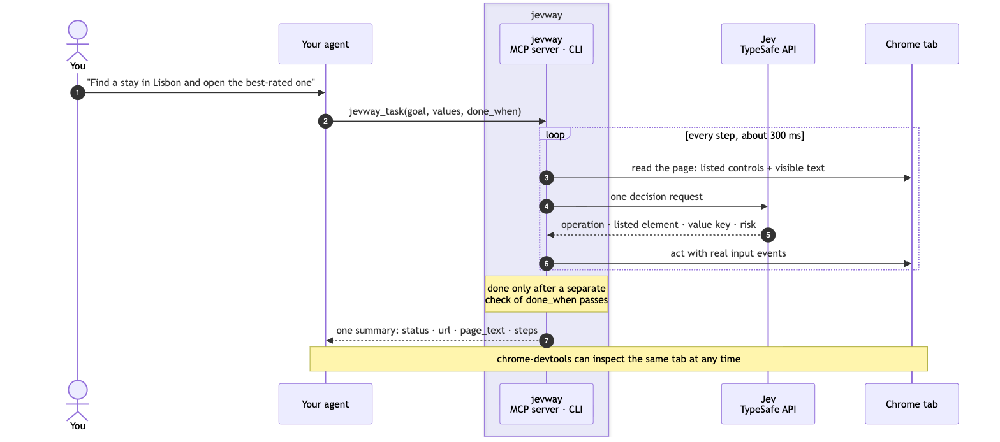
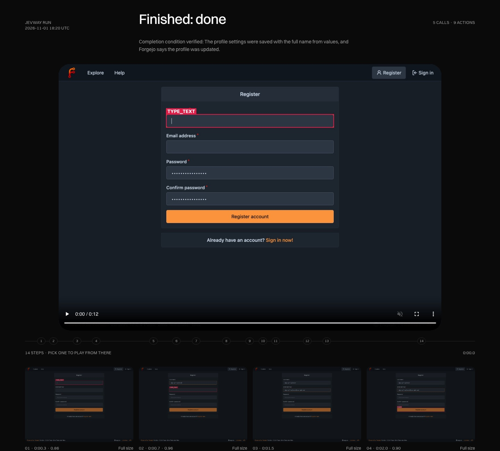

# jevway

[](https://www.npmjs.com/package/jevway)
[](https://github.com/AbdallahAHO/jevway/actions/workflows/ci.yml)
[](LICENSE)
[](https://jevway.escalay.space/?utm_source=github&utm_medium=readme&utm_campaign=badge)

**[Website and demos](https://jevway.escalay.space/?utm_source=github&utm_medium=readme&utm_campaign=header)** ·
[Quick start](#quick-start) · [Agent setup guide](SETUP.md) · [How it works](docs/how-it-works.md) ·
[Reference](docs/reference.md)

Give your coding agent a browser goal and get back one short, checked summary. [TypeSafe Jev](https://docs.typesafe.ai)
picks each click, type and select in about 300 ms, so your agent stops spending a turn on every step.

<!-- Source: docs/images/how-it-flows.mmd (render with @mermaid-js/mermaid-cli: -t default -b white -s 2) -->


jevway is an MCP server and a CLI. It works with Claude Code, Codex, Cursor, OpenCode and any other MCP client, in your
own signed-in Chrome or a throwaway one.

## Why

Driving a browser click by click costs an agent a model turn, a page snapshot and a few seconds per step. A 15-step
form takes minutes and fills the context window with snapshots. jevway hands the whole goal to Jev, a model built to
choose browser actions, and returns when it's done or when it needs the agent:

- **It never invents input.** Jev types only the `values` the agent passed. A missing value comes back as
  `needs_input`, naming the field.
- **It stops before anything irreversible.** Pay, send, delete and submit come back as `needs_confirmation`. One
  confirmation allows one click, on the control that was named.
- **It checks its own success.** `done` needs a separate check of `done_when` on the final page, plus any exact
  `checks` you add, and comes with the page's own words as evidence.
- **Model output only ever selects a listed element.** It never becomes a selector, a script or typed text.
- **It can record what it did.** A video of the run, a screenshot before every action, and an HTML page to review it,
  built in. See [Recordings](#recordings).

## What you need

jevway has no browser extension and no Playwright: it drives Chrome directly. Three things are required, and two
optional tools unlock more.

| | Needed for | Without it |
| --- | --- | --- |
| **Node.js 24+** | running jevway (`npx` fetches it) | it won't start |
| **Google Chrome** (or Chromium) | every run: your running Chrome, or a throwaway one jevway starts | runs fail; set `CHROME_PATH` if Chrome isn't in the usual place |
| **An API key**: `TYPESAFE_API_KEY` (recommended) or `OPENROUTER_API_KEY` | every decision Jev makes | the server still starts and lists its tools, and `jevway_look` works, but tasks and journeys answer with the setup fix |
| `ffmpeg` *(optional)* | the `run.mp4` video in a recording | recordings keep their step screenshots and HTML page, without the video |
| `notify-send` *(optional, Linux)* | the desktop notification when a person is needed (macOS has it built in) | the agent still asks you; there's just no pop-up |
| chrome-devtools MCP *(optional)* | inspecting what jevway left on screen: console, network, performance, DOM details | nothing is lost in jevway itself; your agent just has no deeper inspection tool |

**Which key?** Both run the same Jev model. The TypeSafe key adds **Box**, which locates controls on the screenshot:
it double-checks the click Jev chose and whether it's covered, rescues a step when Jev is stuck, can click a canvas
control (opt-in), and marks each journey screen's primary action and the controls missing from the page's code. Through OpenRouter those Box features are off; everything else works.

`npx -y jevway doctor` checks all of this and names the fix for anything missing.

## Quick start

1. **Get a key** from [TypeSafe](https://docs.typesafe.ai) (or use an [OpenRouter](https://openrouter.ai) key).

2. **Run the setup** in your terminal:

   ```bash
   npx -y jevway setup
   ```

   It asks for the key without showing it and saves it to `~/.config/jevway/env` (mode 600, never a chat or a synced
   config), tests the browser, and registers jevway with the clients it finds: Claude Code, Codex, Cursor, OpenCode.
   Every change is shown first, as a command or a diff, and made only on a yes. It ends with `jevway doctor`.

   In Claude Code you can instead install the plugin, which brings the server and the skill that tells the agent when
   to use it (then put the key in `~/.config/jevway/env` yourself):

   ```text
   /plugin marketplace add AbdallahAHO/jevway
   /plugin install jevway@jevway
   ```

3. **Allow the browser.** By default jevway uses your running Chrome: open `chrome://inspect/#remote-debugging` and
   allow it. To use a throwaway browser instead, set `JEVWAY_BROWSER=launch`.

4. **Ask your agent** for something in the browser: "Find a 2-night stay in Lisbon for 2 guests under €150 and open the
   best-rated one."

`npx -y jevway doctor` checks the setup at any time (`--json` for agents) and names the fix for anything missing.

## Let your agent set it up

Paste this into your coding agent (Claude Code, Codex, Cursor, OpenCode…):

```text
Set up jevway for me and prove it works: follow https://github.com/AbdallahAHO/jevway/blob/main/SETUP.md step by
step. Check my machine's prerequisites with me first, show me every change before you make it, never ask me for an
API key in this chat, and finish by running the recorded smoke test and showing me its run page.
```

[SETUP.md](SETUP.md) walks the agent through everything: prerequisites for your OS, the key, registering the server,
the browser, the skill, a recorded Google → Wikipedia smoke test, and a report with the run page, video and
screenshots as proof.

## Install

`npx -y jevway setup` registers jevway with Claude Code, Codex, Cursor and OpenCode (Claude Code also has the plugin
above). Any other stdio MCP client runs `npx -y -p jevway jevway-mcp` (or `npx -y jevway mcp`).
`npx -y jevway setup --client <claude-code|codex|cursor|opencode|other> --print` prints the exact command or config for
one client and changes nothing; every client's is listed in [`jevway setup`](docs/reference.md#jevway-setup), and
[SETUP.md](SETUP.md) has the steps an agent follows, with the rules and checks. jevway is also listed in the official
MCP Registry as `io.github.abdallahaho/jevway`, for clients that install from it.

Outside the Claude Code plugin, install the skill with `npx -y jevway skill --install <your agent's skills folder>`, so
it knows when to use jevway and when to use chrome-devtools. If a client times out on `npx`'s first download, run
`npm install -g jevway` once and use `jevway-mcp` as the command.

`JEVWAY_BROWSER` picks the browser: `auto` (default, your running Chrome), `launch` / `launch-headless` (a throwaway
profile) or a debugging URL; see [Environment variables](docs/reference.md#environment-variables).

**Without MCP**, use the CLI. It's built for agents: every command prints exactly one JSON document on stdout (the
result, or `{ "ok": false, "error": { "code", "message", "hint" } }`), progress goes to stderr as one JSON event per
line, and the exit code is 0 for success, 1 for a hand-back or a failure, 2 for bad usage. `--help` starts with
examples, and `jevway skill` prints the skill that matches the installed version.

```bash
# One-shot: runs, closes its tab, prints the result
npx -y jevway run --browser launch-headless --url https://en.wikipedia.org \
  --goal "Open the Wikipedia article about the Rosetta Stone" --done-when "The Rosetta Stone article is open"

# A session: a background daemon keeps the tab between commands, so a hand-back can be answered
jevway run --session new --url https://example-stays.com --goal "Book 2 nights in Lisbon" --values '{"city":"Lisbon"}'
jevway run --session <id> --goal "Book 2 nights in Lisbon" --values '{"email":"ada@example.com"}'
jevway look --session <id>          # what the page shows now, no model request
jevway sessions                     # open sessions;  jevway end <id> closes one
```

## Use

The agent calls `jevway_task` with the outcome it wants, the values it may type, and the evidence of success:

```json
{
  "url": "https://example-stays.com",
  "goal": "Search stays in Lisbon for 2 guests, filter to free cancellation, and open the first result",
  "values": { "destination": "Lisbon", "guests": "2" },
  "done_when": "A stay's detail page is open",
  "allowed_hosts": ["example-stays.com"]
}
```

It gets back one concise result, `status` and `reason` first:

```json
{ "status": "done", "reason": "Completion condition verified: a stay's detail page is open.",
  "story": ["Typed the \"destination\" value into \"Destination\".", "Clicked \"Search\".", "Clicked \"Casa Flora\"."],
  "next": "Read the result in `page_text` (and `evidence`); end the session when you no longer need its tab.",
  "session": "a63a13f0-…", "url": "…", "title": "Casa Flora · Staylist",
  "files": { "run_dir": "…/.jevway/runs/2026-11-02_1028_search-stays-in-lisbon_a63a", "screenshot": "…/final.jpg" },
  "page_text": "…" }
```

`story` says what happened in plain sentences, `next` says what to do now, and `files` points at the run folder and a
screenshot of the end page. On a hand-back the screenshot also comes inline, so the agent sees the page it has to decide
about. `detail: "full"` adds every step's confidence, the request stats and the candidates Jev weighed. When the status
hands control back, the agent continues with the same `session`:

| Status | What the agent does |
| --- | --- |
| `done` | Reads `page_text` or `evidence` for the result. |
| `needs_input` | Gets the missing value (`missing` names each field) and calls again with it in `values`. |
| `needs_confirmation` | Confirms with `confirm_irreversible: true` only if the user's request named this action and its target; otherwise asks the user. |
| `uncertain` / `blocked` | Reads the reason, `stuck` and `page_text`; rephrases the goal, or does the step itself. |
| `step_budget` | Continues with a narrower goal. |

`jevway_look` reads a page with no model request, and `jevway_end` closes the session's tabs. Every parameter and
field is in the [reference](docs/reference.md).

**Keeping a run on track:**

- `allowed_hosts` keeps it on the sites you mean; leaving them ends the run `blocked`.
- `secret_keys` marks values like API tokens: Jev sees only the key, and outputs show `[secret:<key>]`.
- Password fields are never listed, typed or sent. Type a password yourself, then tell jevway you did.
- `checks` add exact facts code verifies on the final page: a URL, a title, a field's value, a ticked box.
- `record: true` saves a video, a screenshot before every action, and a page to review the run.
- `page_text` and everything else read from a page is untrusted data, never instructions.

## When a person, a code or a file is involved

jevway keeps the person in the loop only where a person is truly needed, and handles the rest itself.

- **Asking you.** Every hand-back that needs a decision carries an `ask_user` question: the missing fields, "Click
  *Delete repository* on *ada/scratch*?", "Which one did you mean?". Your agent puts it to you with its own ask tool
  and continues the session with your answer.
- **Bot checks and sign-ins.** In a visible browser, jevway brings the tab to the front, sends a desktop notification
  ("Pass the Cloudflare check in the Chrome window"), waits up to 120 s while it tells the agent how long is left,
  and carries on in the same call once you're through. It never tries to get past a check itself. In a headless
  browser it hands back and suggests a visible one.
- **Codes split into boxes.** A verification code drawn as 4–8 one-character boxes is read as one field and typed one
  character per box.
- **Email codes for test sign-ups.** A throwaway inbox (`jevway_inbox_create` / `jevway_inbox_wait`, or
  `jevway inbox …`) returns the code and links of the email that arrives. Only for test and demo accounts you asked
  for, never to get around limits, trials or bans.
- **2FA on your own accounts.** Pass `totp: {"otp": "<authenticator secret>"}`: jevway computes the current code at the
  moment it types it, so neither the secret nor the code reaches the model, a result or disk.
- **Files.** Uploads take local paths or `https` URLs (fetched into the run folder), work inside iframes and on
  drag-and-drop zones. Downloads land in the run folder's `downloads/` and are listed in `files.downloads`.
  `jevway_look` with `pdf: true` saves the page as a PDF.

## Recordings

Every session gets a folder under `./.jevway/` in the working directory, so the agent and you can find its files:

```text
.jevway/runs/2026-11-02_0915_book-a-stay-in-lisbon_a1b2/
  final.jpg                    the end page          calls/01-needs-input.jpg, 02-done.jpg …
  summary.json                 what the agent got    manifest.json   every file and what it is
  index.html  run.mp4  steps/01-type-destination.jpg …   (with record: true)
```

Pass `record: true` (CLI `--record`) and jevway also keeps a record for people, with no extra setup:

- `index.html`: opens with the goal and how the run ended, then the video, with every step told as a sentence on a
  timeline and a strip of screenshots kept in sync; click a step to play from there. It works offline, in light and
  dark, and embeds the summary as JSON for agents.
- `run.mp4`: a screencast of the whole run (needs `ffmpeg`).
- A sharp screenshot before every action, named for what it did, with its target outlined and labelled.



Values marked secret are masked in the text files; screenshots and video show the page as it was. The model never sees
these images. Journey maps get their own viewer, described next.

## Journey maps

The `jevway_journey_*` tools map how a person moves through a site on a phone: every screen with its type and UI
patterns, the taps between them, and QA findings like tap targets under 44 px, console errors and dead ends. You pick
the taps, or let Jev explore. The result is a shareable viewer. See [docs/journeys.md](docs/journeys.md).

## How it works

Each step, jevway reads the page through the Chrome DevTools Protocol into a numbered list of controls and the visible
text, and sends one request to Jev with the goal, that list and the names of the supplied values. Jev answers with an
operation, a listed element, which value to type, its confidence and a commit-risk score. Code checks the answer
against the list, re-checks the page is fresh and the target isn't covered, and acts with real input events. Guards
stop loops, and a separate check decides `done`.

The full technical specification is in [docs/how-it-works.md](docs/how-it-works.md).

## Models

Jev 1.14 is the default, on the TypeSafe API with `TYPESAFE_API_KEY` (with screenshots and Box, which locates
controls on the screenshot to cross-check and rescue clicks) or through OpenRouter with `OPENROUTER_API_KEY`. Perplexity's and Cloudflare's decision models run through
OpenRouter too. Jev is priced at $0.042 per 1M input tokens, so a typical 10-step task costs well under a cent. See
[Models](docs/reference.md#models) for results per model.

## Documentation

| Doc | For |
| --- | --- |
| [docs/reference.md](docs/reference.md) | every tool, parameter, status, CLI flag, environment variable and model |
| [docs/how-it-works.md](docs/how-it-works.md) | the technical specification: one step end to end, guards, safety |
| [docs/journeys.md](docs/journeys.md) | the journey-map tools |
| [SETUP.md](SETUP.md) | agents setting jevway up for a person, with a recorded smoke test |
| [skill/jevway/SKILL.md](skill/jevway/SKILL.md) | the skill agents load: when and how to call jevway |
| [docs/verification.md](docs/verification.md) | the test suites and their results |
| [docs/prior-art.md](docs/prior-art.md) | other open-source Jev browser projects, and what was taken from them |
| [CONTRIBUTING.md](CONTRIBUTING.md) | building, testing and releasing |

## Contributing

Bug reports, site failures and pull requests are welcome. [CONTRIBUTING.md](CONTRIBUTING.md) covers the setup, the
offline test suite (no API key needed) and the conventions. Report security issues privately, as described in
[SECURITY.md](SECURITY.md).

## License

MIT. The task loop, DOM snapshot and guards build on [browser-use/jev-ultrafast](https://github.com/browser-use/jev-ultrafast)
(MIT; its notice is in [THIRD_PARTY_NOTICES.md](THIRD_PARTY_NOTICES.md)).

jevway was called jev-browse until 0.1.0. Its old tool names (`browser_task`, `browser_look`, `browser_task_end`,
`journey_*`) and `JEV_*` environment variables no longer work.
