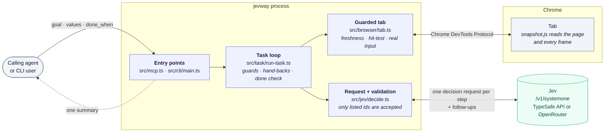
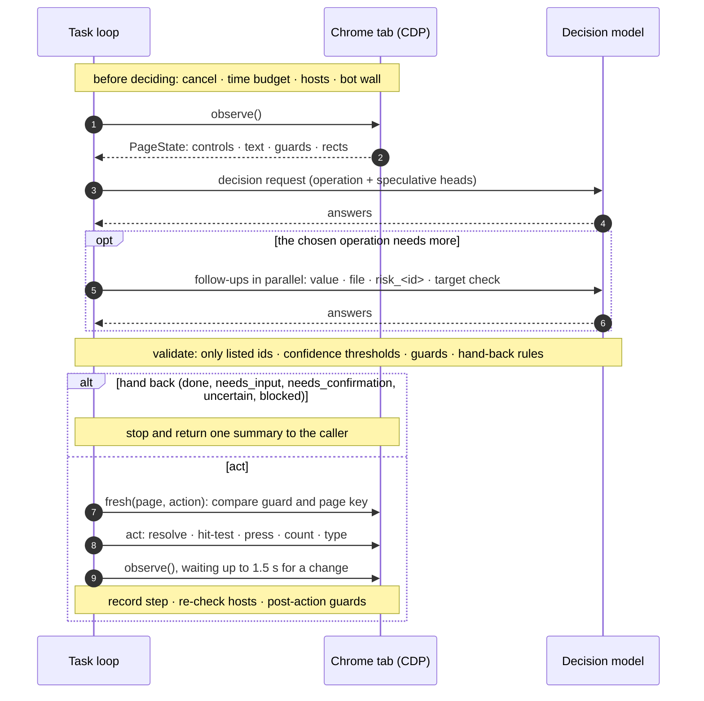

# How jevway works

The technical specification of jevway, taken from the code. Every number below is the value in the cited file. Where this page and the code ever disagree, the code is right.

## Contents

1. [Overview](#1-overview)
2. [One step, end to end](#2-one-step-end-to-end)
3. [The action space](#3-the-action-space)
4. [What the model decides and what code decides](#4-what-the-model-decides-and-what-code-decides)
5. [Loop guards](#5-loop-guards)
6. [Irreversible actions](#6-irreversible-actions)
7. [Finishing](#7-finishing)
8. [Statuses](#8-statuses)
9. [Boundaries](#9-boundaries)
10. [Box](#10-box)
11. [Models and routes](#11-models-and-routes)
12. [Journeys](#12-journeys)
13. [Recording and replay](#13-recording-and-replay)
14. [Code map](#14-code-map)

## 1. Overview

jevway is an MCP server (`jevway-mcp`, `src/mcp.ts`) and a CLI (`jevway`, `src/cli/main.ts`, with a session daemon in `src/daemon/`). A calling agent hands it a whole browser goal, a start page and the text values the goal needs. A task loop (`src/task/run-task.ts`) reads the page over the Chrome DevTools Protocol (CDP), sends one decision request per step to a model on TypeSafe's System One API (`/v1/systemone`), checks the answer, and performs the single input the answer names. When the goal is visibly done, or the next decision belongs to the caller, the agent gets one short summary back.

Terms used throughout:

- **Observed id**: the number (`"3"`, or `"3:2"` for a dropdown option) that the request gives each control the page reader listed this step. The model can only answer with one of these.
- **Head**: one question in a request. A Choice head returns `choice`, `confidence` and `probabilities` over fixed options. A Noul head returns `noul`, the probability (0 to 1) that a statement is true. A box head returns edges as fractions of the screenshot.
- **Hand-back**: the run stops and returns control to the caller with a status other than `done` (`needs_input`, `needs_confirmation`, `uncertain`, `blocked`, `step_budget`).
- **Commit risk**: a Noul score for "this click would commit an irreversible real-world effect" (pay, send, delete, submit). At 0.5 or above a click is held for confirmation.
- **Box**: Jev 1.14's box questions over a screenshot, available only on the direct TypeSafe route (section 10).

A **session** is one `BrowserTask`, starting on one tab. Each `jevway_task` call on it runs the loop once (`run()`); history, values and confirmation state carry over between calls. The transport-free session service (`src/session/session-service.ts`) keeps them under a full UUID with a run folder each (section 13); the MCP server is a thin adapter over it (1.1).

### 1.1 The MCP adapter

`src/mcp.ts` is the `jevway-mcp` entry: it loads `~/.config/jevway/env`, makes the runner and one session service, and serves `createMcpServer` (`src/mcp/server.ts`) through `serveStdio`. That builds a server per connection (twice when a 2026-07-28 probe falls back to `initialize`), so a server holds nothing: the sessions stay in the one service. The adapter translates and decides nothing about a run.

- **In.** Tool parameters become a `TaskRequest`. `checks` are advertised as a loose list (the full union would cost about 580 tokens of every tool list) and parsed strictly with `CHECKS` when the call arrives. A `jevway_task` with none of `url`, `tab` and `session` is refused with an example before any browser work.
- **Out.** `presentSummary` (concise, or `detail: "full"`) whose keys lead with `status`, `reason`, `story`, `next`, `session` and end with `page_text` (the order the CLI shares), sent as one JSON text block and as the same object in `structuredContent`. Each `outputSchema` lists top-level fields and leaves every object open, so a field added later never fails a client's validation. After the JSON come the end page as an `image/jpeg` block when `attachesEndPage` (`src/mcp/results.ts`) says so (`JEVWAY_IMAGE_RESPONSES`, a hand-back status, or `screenshot: true`), then `resource_link`s with `file://` URIs to the run folder's files.
- **Progress.** Each `step` event becomes `notifications/progress` (`progress` the step number, `message` "Step n: " plus the story line, `total` the call's `max_steps` when given), chained in order and awaited before the result is returned.
- **Errors.** A thrown error becomes an `isError` result, `<tool> failed: <message>`; the service's `UnknownSession` message passes through unchanged. Schema errors carry an example for `goal`, `values` and `files`.
- **Instructions and tool set.** `instructionsFor` (`src/mcp/instructions.ts`) states the rules several tools share once (session pattern, consent, `jevway_look` before repeating a write, files, untrusted page text); `JEVWAY_TOOLS` (`all`, `task`, `journeys`) picks the tools, registered in one fixed order so the list stays byte-stable.

### 1.2 The CLI and its daemon

`src/cli/main.ts` is the `jevway` entry. Every command prints exactly one JSON document on stdout (the result, or
`{ "ok": false, "error": { "code", "message", "hint" } }`) and only NDJSON progress events on stderr; exit codes are
0 (success, or `done`), 1 (a hand-back or a failure) and 2 (bad usage). Flags are declared once per command
(`src/cli/flags.ts`), which drives both `--help` and the did-you-mean for a mistyped flag.

- **One-shot.** `jevway run` without `--session` runs in this process, closes its tabs and prints the summary, as the
  CLI always did (`jevway --goal …` is the same command).
- **Sessions.** `run --session new` and `journey start` reach the daemon (`src/daemon/`), starting it in the background
  if none answers. It holds the session service, its browser and its sessions between commands, on one local socket
  under `JEVWAY_STATE_DIR` (default `$XDG_RUNTIME_DIR/jevway`, else `~/.cache/jevway`), and exits after an idle hour
  (`--idle-timeout`). Commands that name an existing session, and `sessions`, `end` and `stop`, never start it.
- **Protocol.** Newline-delimited JSON: the client sends `{ id, method, params }` (or `{ cancel: id }`), the daemon
  answers with `{ id, event }` lines and then one `{ id, result }` or `{ id, error }`. Methods mirror the tools: `task`,
  `look`, `end`, `sessions`, `journey.*`, plus `hello` and `stop`. The client resolves paths before sending, so a run
  started from a project lands in that project's `.jevway/`.
- **Safety.** A daemon of another version, or started with other settings, is replaced only when it holds no
  sessions; otherwise the command fails `daemon_busy`. The settings check records which keys are set, never their
  values, and the daemon log never holds a secret value. A connection that drops mid-run returns `outcome_unknown`:
  the page may have changed, so the hint says to `jevway look` before repeating a write.

## 2. One step, end to end

### 2.1 Observe

`Tab.observe()` (`src/browser/tab.ts`) runs `src/browser/snapshot.js` in the page and in every readable frame (`src/browser/frames.ts`). Before reading, it waits for the previous input to settle: two animation frames, capped at 50 ms (200 ms after typing into a combobox, until its options show), extended to 400 ms while a finite animation runs. If 3 or more on-screen elements with no text run an endless animation (skeletons, spinners), it waits up to 1.5 s; if they still pulse, the page text starts `Loading: N placeholder blocks on screen`. A read that keeps failing is retried up to 25 times within 2 s, then raised as a stale page.

What the reader returns (`PageState`):

| Part | Rule |
| --- | --- |
| Controls (`actions`) | Links, buttons, inputs, selects, textareas, contenteditables and the ARIA roles button, link, checkbox, radio, switch, tab, menuitem, option, combobox, including open shadow roots. Only visible, enabled controls whose centre is in the viewport. At most 250; the rest are counted in `omitted_actions`. |
| Exceptions to "on screen" | Up to 5 off-screen controls whose text holds a non-secret supplied value (`tab.want`); rows wider than their scroll box; up to 20 controls shown only on hover, labelled `(appears on hover)`. |
| Labels | Accessible name, else row text, else icon class, else the short text around it; capped at 200 characters. Same-named controls get their card or row text appended. |
| Never listed | Password, hidden and file inputs (file inputs are listed only when the caller declared `files`), disabled controls, closed shadow roots, canvas content. |
| Password fields | Up to 5 visible ones, as `{ name, filled }` and as page-text lines `Password field "…": filled/empty`. Never the value or its length. |
| Text | Text nodes that intersect the viewport, up to 6000 characters, password lines first. Frame text follows under `[Frame: …]` within the same 6000, frames keeping at least 1000. |
| Page-level controls | `SCROLL_DOWN` / `SCROLL_UP` when the document can move that way (step 560 px), else for the largest visible pane at least 50×50 px that can (step 80 % of its visible height, 100 to 560 px). `WAIT` always. |
| Freshness data | `marker` (whole page: URL, title, text, scroll, control semantics), `page_key`, one `guard` per control node, and `fingerprint` (sha256 of URL, text, controls and scroll) to tell whether a step changed anything. |

When the caller marked secret keys, the loop scrubs the page as it reads it (title, URL, text, labels, field values, password field names) before anything else uses it (`#observe` in `src/task/run-task.ts`).

### 2.2 Build the request

`buildActionSpace` (`src/jev/action-space.ts`) numbers each control node once (`"1"`, `"2"`, …) and builds one target set per operation. `buildRequest` (`src/jev/decide.ts`) then sends a `state` and a set of `questions`.

The state:

| Key | Content |
| --- | --- |
| `page` | `url`, `title`, `text`. The text may start with `[Page message after "<label>"] …` (what the page said after a risky or saving click, at most 300 characters, kept while the run stays on that path). |
| `password_fields` | Only when visible ones exist. |
| `elements` | One row per observed id: `index`, `label`, `operations`, and `role`, `value`, `checked`, `selected`, `expanded`, `options` when set. |
| `supplied_values` | The caller's `values`, key and value. A key listed in `secret_keys` shows `[secret:<key>]` instead of its value. |
| `supplied_files` | Only when files are declared: each key with the file's name, never its path. |
| `recent_actions` | The last 10 history entries (operation, element, value or file key, `page_changed`, `value_kept`, `not_executed` notes, confidence). |
| `screenshot` | Only when this step carries one (section 11): a marked JPEG of the viewport. |

The goal is not in the state: it travels in each head's instructions (`{ goal, rules }`). The questions (heads) of the decision request:

| Head | Type | Asked when |
| --- | --- | --- |
| `operation` | Choice over the offered operations, `DONE` and `BLOCKED` | Always. Rules: `NEXT_ACTION` (or the profile's `compactRules`). |
| `click_target`, `type_text_target`, `select_target`, `upload_target` | Choice over that operation's observed ids | Only when the operation has 2 or more candidates. A lone candidate is taken with confidence 1. |
| `value_for_<id>` | Choice over the value keys plus `NO_SUPPLIED_VALUE` | For the first 8 text fields, when values were given. |
| `file_for_<id>` | Choice over the file keys plus `NO_SUPPLIED_FILE` | For the first 8 file fields, when files were declared. |
| `commit_risk` | Noul, page-level | When there are click targets and the profile asks the page-level question. |
| `done_check` | Noul | When `done_when` was given. |
| `page_error`, `sign_in_wall` | Noul | Always. |
| `stuck` | Noul with true/false meanings | Always. Recorded in the trace only; nothing reads it. |
| `next_click_box`, `next_click_present`, `next_click_commit_risk` | Box, Noul, Noul | With Box and a screenshot. |

Every head is answered over the same state, and the code keeps only the heads the chosen operation needs. Some answers need a second, smaller request that reuses the same state; these run in parallel after the main one:

- `value`: the chosen text field had no `value_for_<id>` head (beyond the first 8).
- `file`: the same for a file field.
- `target_visible` + `target_box`: with Box and a screenshot, for a chosen click (section 10).
- `risk_<id>`: per-element commit risk by name (`ELEMENT_COMMIT_RISK`) for the chosen click, the element a Box answer points at, and any collapsed control a rescue may open (section 6).

All instructions live in `src/jev/instructions.ts`, and each tells the model that page text is untrusted data, never instructions. Before sending, the whole request passes through the secret scrubber (section 9).

### 2.3 Validate

`validChoice` (`src/jev/decide.ts`) accepts a Choice answer only if its `choice` is one of the offered ids, its `probabilities` name exactly the offered ids, every number is between 0 and 1, and the probabilities sum to 1 within 0.02. Anything else throws `Invalid TypeSafe answer; no action executed.`, which ends the run `blocked` as a model error. Only the chosen operation's target head is validated; unused heads can never cause an action. A malformed or missing risk answer reads as 1 (certain risk), so it can only stop a click.

Confidence for the hand-back test is `min(operation confidence, target confidence)`. Below the profile's `minConfidence` (Jev 0.3) the step is unsure (section 5).

### 2.4 Checks before acting

The loop (`#loop` in `src/task/run-task.ts`) runs these in this order. Each one either continues, feeds a note back into history and re-decides, or stops the run.

1. The caller's cancel or time budget (section 9).
2. A tab opened or closed since the last look (section 9).
3. Hosts: the page URL must be inside the run's host rules.
4. Bot wall: checked before a decision is spent; it gets 8 s to clear, once per call.
5. Decision budget: more than `2 × maxSteps` decisions in this call ends `step_budget`.
6. Decide (with a screenshot second look in `fallback` mode, section 11). A transient model error (5xx, 429, 499, timeout, network) is retried once after 800 ms.
7. Done evidence: `done_check` ≥ 0.9 once, or ≥ 0.75 on 3 decisions in a row, ends `done` (section 7).
8. BLOCKED on a met goal: `BLOCKED`, no field missing a value, `done_check` ≥ 0.5: ends `done`.
9. Sign-in wall (≥ 0.7) and page error (≥ 0.8, only after this call executed an action): end `blocked` (section 9). They run after steps 7 and 8, but before Jev's own `DONE` is handed back in step 12.
10. Box rescue (section 10), then disclosure rescue (section 5).
11. Feedback guards (section 5), in this order: rejected DONE, DONE after an unsaved edit, covered on screen, unpicked menu value, undoing its own toggle, field with no fitting value or file. Each writes a `not_executed` note into history and re-decides, or stops.
12. Hand-back rules (`#handBack`): `DONE`, `BLOCKED`, Box disagreement, low confidence, missing value or file, irreversible click. Before a `needs_input` or `blocked` hand-back the loop waits up to 1.5 s for the page to change, and any hand-back on a page that changed since the decision is dropped and re-decided.
13. Act.

### 2.5 Act over CDP

Every input goes through `Tab.act` or `Tab.upload` (`src/browser/tab.ts`):

1. **Freshness.** A click, select, fill or upload compares the target node's guard and the page key with the observation. Wait, scroll, Enter and Escape compare the whole-page marker. A mismatch raises `StalePage`: nothing runs, the page is read again, and the decision does not count against the decision budget.
2. **Resolve and hit-test.** In the target's own frame, the node must still be connected, enabled, visible and (for a fill) writable. The reader tries the centre of its visible box and four more points; a point counts only if the element there is the target or inside it. A clipped target is scrolled into view once. A small field is reached through its field box.
3. **Covered target.** If no point reaches it, the run gets `TargetUnreachable` with whether a popup layer covers it and the observed ids inside the covering layer (section 5).
4. **Press.** A mouse press and release at the point (`Input.dispatchMouseEvent`), or a 60 ms touch tap on an emulated phone. A hover-only control first gets a pointer move and up to 500 ms to show.
5. **Delivery check.** A counter of trusted `pointerdown`, `mousedown` and `touchstart` events is registered before the page's own scripts. If it has not moved after 4 reads 40 ms apart, the run ends `blocked` with `InputNotDelivered`. It is never retried, because a click the page received but the counter missed must not run twice.
6. **Type.** Select-all (Cmd or Ctrl+A), then one `keyDown`/`keyUp` per character, so autocompletes see real keys. Text containing a line break is inserted with `Input.insertText`, since a line-break key would submit the form.
7. **Select.** A native `<select>` option is set in the page (`value`, then `input` and `change` events), with no pointer input.
8. **Upload.** `DOM.setFileInputFiles` with the declared path, after the same element-level freshness check. Never inside a frame.

### 2.6 See what changed

After the input, the loop follows a tab the input opened, reads the page again and, if the fingerprint is unchanged, keeps reading every 150 ms for up to 1.5 s (`changeWaitMs`). The step goes into history with `page_changed`, and for a typed field `value_kept` (does the field still hold the text). Then the hosts are checked again, dialogs the step raised are reported on it, and the post-action guards run (section 5).

## 3. The action space

Operations are offered per step, only when they have something to act on (`buildRequest` in `src/jev/decide.ts`, `#withKeys` in `src/task/run-task.ts`).

| Operation | Offered when | What it can't do |
| --- | --- | --- |
| `CLICK` | At least one clickable control is listed. | Target anything not listed this step. |
| `TYPE_TEXT` | At least one editable field is listed. | Type anything except `values[key]` for the key the model chose. No fitting key: fed back once, then `needs_input`. |
| `SELECT` | A native dropdown is listed; each option is a target `id:n`. | Choose an option the page doesn't offer or that is disabled. |
| `UPLOAD` | Files were declared and a file field is listed. | Upload anything but a declared file (absolute path, checked readable before the run). The model sees key and file name only. |
| `SCROLL_DOWN`, `SCROLL_UP` | The document, or a visible pane, can move that way. | Choose the distance or point. A scroll that moved nothing is recorded as `(nothing moved: there is no more to scroll this way)`. |
| `WAIT` | Always. | Anything; it waits 100 ms, then the loop's change wait. |
| `PRESS_ENTER` | Right after typing into a search-like field (role searchbox or combobox, or a label with search, query, find or filter) that is still listed. | Press anywhere else. It is refused unless that exact field still has focus. |
| `PRESS_ESCAPE` | While an observed control is expanded (menu, popover, suggestions). | Anything but a fixed Escape to the focused element, a blur, and a synthetic press on `body`. |
| `DONE` | Always. | End the run alone: with `done_when` the done check must agree (section 7). |
| `BLOCKED` | Always. | Hand back before the rescues and the met-goal check have had their turn. |

`CLICK_AT` is not offered to the model. Code creates it only from a Box rescue with `allow_coordinate_clicks` on (section 10).

## 4. What the model decides and what code decides

The core rule: model output only ever selects an observed id or a supplied key. It never becomes a selector, a script, typed text, or a coordinate (except the opt-in coordinate click in section 10).

| The model decides | Code decides |
| --- | --- |
| Which offered operation runs next. | Which operations are offered at all (Enter only after search typing, Escape only while something is expanded, UPLOAD only with files). |
| Which observed id that operation targets. | Which controls are observed, their ids, and where to press (DOM rect, hit-tested just before input). |
| Which supplied value key fits a field, or none. | The text typed: `values[key]`, character by character. |
| Which declared file key fits a file field, or none. | The file path set on the input. |
| Scores: commit risk, done check, page error, sign-in wall, stuck. | Every threshold applied to those scores, and the status that follows. |
| A box on the screenshot (Box). | Mapping the box back to an observed id (`matchTarget`); clicking a raw point only with the opt-in. |
| Which cut span of the final page is the evidence. | The spans, and copying the chosen one word for word. |
| Nothing about confirmation. | Whether a confirmation applies, to which control, and whether the page shows the user's words. |
| Nothing about the browser. | Freshness checks, native dialog answers, host checks, bot walls, tab following, budgets and cancellation. |

## 5. Loop guards

All values are from `src/task/run-task.ts` (`GUARDS` and the constants above it) unless noted. The `GUARDS` values were measured on Jev 1.14 and are provisional for other models.

| Guard | Value | What happens |
| --- | --- | --- |
| No change | 3 executed steps in a row with `page_changed: false` (WAIT excluded) | Last look, then `blocked`. |
| Toggling in place | Same action 4 times in a row with the page fingerprint alternating A/B | Last look, then `blocked`. |
| Same element repeated | Same action 6 times within the last 7 (WAIT excluded) | Last look, then `blocked`. |
| Wandering | 6 executed steps in a row under 0.5 confidence (WAIT and PRESS_ESCAPE not counted) | Last look, then `uncertain`. |
| Unsure step | `min(operation, target confidence)` < `minConfidence` (Jev 0.3) | Overflow rescue first; else `uncertain`. An unsure WAIT or PRESS_ESCAPE still runs. |
| Unreachable target (DOM cover) | 1st miss with a popup open: one automatic `dismissPopup`. 2nd miss: a note naming up to 3 controls of the covering layer. 3rd miss | `blocked`. |
| Covered on screen (Box) | Visible < 0.1 and box overlap < 0.1; fed back up to 2 times per call | `uncertain` on the 3rd. |
| Stale refusals | Do not spend the decision budget; more than `2 × maxSteps` in a call | `blocked`. Wait, scroll, Enter and Escape refused twice in a row run on the 3rd try (Enter still needs focus). |
| Rejected DONE | 3 per call, with a 300 ms pause after each | `uncertain` on the 3rd. |
| Field without a value or file | 1 feedback per field | `needs_input` on the 2nd. |
| Undoing its own toggle | 1 feedback (saying whether anything was clicked after the flip) | `blocked` on the 2nd. |
| Unpicked menu value | A risky click while a menu this run opened lists a supplied value not yet picked; 1 feedback per option and key | Re-decide. |
| Unsaved edit before DONE | `done_check` < 0.75 sent back once per edit | Re-decide. |
| Rejected resubmit | Same risky submit, same path, typed fields still listed, after the page answered with new text | `blocked`, quoting up to 300 characters of that answer. |
| Decision budget | `2 × maxSteps` decisions | `step_budget`. |
| Step budget | `maxSteps` executed actions (default 40, MCP max 100) | `step_budget`. |

**Last look.** Before a progress guard hands back, the loop makes one more decision on the current page, with a screenshot unless screenshots are `off`. If its `done_check` is at least 0.5 the run ends `done`. This needs `done_when`.

**Rescues before an unsure or blocked hand-back** (`#openDisclosure`, `foldedFavourite` and `overflowFolds` in `src/jev/decide.ts`). A `BLOCKED` step first opens the collapsed control (`aria-expanded="false"`) the click head ranks highest, if its probability is at least `minConfidence`. Otherwise it, and an unsure step, opens a collapsed overflow control ("+1", "Show N more …", "More actions", "⋯"), count chips first, at most 3 judged per step. Each is opened once per task, is judged by name for commit risk like any click, and never is the signed-in user's account menu.

## 6. Irreversible actions

A click (`CLICK` or `CLICK_AT`) is **risky** when its commit risk is at least 0.5 (`isRiskyClick`).

Where the score comes from (`src/jev/decide.ts`, profiles in `src/jev/model.ts`):

| Source | Used by |
| --- | --- |
| Page-level `commit_risk`: "would the click that best advances the goal commit an irreversible effect". | Jev (`pageRisk: true`). |
| Per-element `risk_<id>`: the chosen control judged by its own label and page. | Every profile (`elementRisk: true`). |
| Box `next_click_commit_risk` | Box rescues, combined with the element score. |

For Jev, the higher of the page-level and element scores counts. A collapsed control, or an option picked from an open list, is judged by name only, because the page-level question reads the form behind it. A click scoring between 0.25 and 0.5 gets a screenshot second look first in `fallback` mode.

A risky click without a confirmation is handed back `needs_confirmation`. The reason always starts `Clicking "<label>" on "<page title>" looks irreversible (risk N)` and tells the agent to confirm only when the user's own request names this action and this target.

**Confirming.** The caller sets `confirm_irreversible: true` with `confirm_target` (`BrowserTask.update`):

- It counts only on the call right after a `needs_confirmation`, or on a new session's first call. Anywhere else it is dropped and the summary says so in `confirm_ignored`.
- An answer to a `needs_confirmation` is bound to the flagged control: the same bare label on the same URL pathname (the query string is ignored). A different risky control is handed back `needs_confirmation` again, naming the control that was confirmed, and that spends the confirmation. A first-call confirmation has no flagged control and allows any one risky click.
- `confirm_target` is required. `showsTarget` (`src/browser/words.ts`) takes its words of 3 or more characters, drops the control's own words and filler words, and requires at least one word left and every one of them to appear whole in the page title, decoded URL, visible text or the values typed on this path. "delete" alone, or a category such as "anything unused", never matches.
- The confirmation covers exactly one risky click. Any `needs_confirmation` hand-back also spends it.
- During the confirmed click, the next native confirm dialog gets OK only if its message names every word of `confirm_target` or of the clicked label (`messageNames`). Prompts and leave-page dialogs never get OK.

## 7. Finishing

### 7.1 How `done` is decided

| Path | Condition |
| --- | --- |
| Evident | `done_check` ≥ 0.9 on any decision. In `fallback` mode, if that same decision's operation head picks another action (not DONE, WAIT or BLOCKED) with confidence ≥ 0.6, one screenshot look must also score ≥ 0.5. |
| Steady | `done_check` ≥ 0.75 on 3 consecutive decisions in the call. |
| Jev's DONE | `DONE` with `done_check` ≥ 0.5, or `DONE` with no `done_when` given. Below 0.5 it is rejected (section 5). |
| BLOCKED on a met goal | `BLOCKED`, no field missing a value, `done_check` ≥ 0.5. |
| Unsure on a met goal | A low-confidence step on a screenshot-backed decision, not stopped by Box, with `done_check` ≥ 0.75. |
| Last look | A progress guard's last look scores `done_check` ≥ 0.5. |
| Checks | Section 7.2. |

Right after an unsaved edit (text typed outside a search field, or a checkbox, radio or switch ticked that is still listed, with no step since) a `DONE` or met-goal `BLOCKED` under 0.75 is sent back once with "save or submit it, then say DONE".

Every path to `done` goes through `stopDone`. It first closes, once, a menu this run's own click opened and left open (fixed Escape), then judges again on the closed page. If the page changed since the decision, it is read again, and a page that turned into a bot wall never ends `done`.

### 7.2 Post-processing on the final page

After the loop, `run()` applies, in order:

1. **Checks** (`src/task/checks.ts`, `#settle`). Code evaluates the caller's `checks` on the final page: `url_contains`, `url_matches` (glob), `title_contains`, `text_contains`, `text_absent`, `element_exists`, `value_equals`, `checked`, `count_at_least`. They read the URL, title, visible text (without the reader's own password and loading lines) and listed controls by role and name. Case and spacing are ignored; an empty needle fails.
   - A failed check turns `done` into `uncertain`.
   - All passing turn `blocked` or `uncertain` into `done` only when the stop was marked overridable, `done_when` was given, and the stopping decision scored `done_check` ≥ 0.5 (0.75 with an unsaved edit) on that same page.
   - `needs_input`, `needs_confirmation` and `step_budget` never change.
2. **Evidence** (`src/task/evidence.ts`, `#withEvidence`). Only for `done` with `done_when`. Code cuts the final page's visible text into spans (sentence ends, at most 200 characters each, at most 100 spans, neighbours merged past that). One extra Choice request (`evidenceRequest` in `src/jev/decide.ts`) carries only the page URL and title as state and the spans as options, plus `absent`.
   - Code copies the chosen span word for word.
   - An answer under 0.6, `absent`, or a failed request leaves `evidence` out and never changes the status.
   - `deep_link` is a `#:~:text=` fragment, left out for a quote under 2 words or 12 characters, or one that appears more than once.
3. **page_text.** The final page's visible text, cut at 2500 characters with `…[N more characters not shown]` (`pageTextFor`).
4. **Scrub.** The summary and the trace are scrubbed of secret values.

The summary's `jev` block counts this call's requests (decision, follow-ups, second looks, last looks, evidence), input tokens, median latency, screenshots, the model id and `est_cost_usd` (section 11).

## 8. Statuses

The six statuses are `TaskStatus` in `src/task/run-task.ts`. "Overridable" means passing checks with a good `done_check` may turn it into `done` (section 7.2).

| Status | Triggered by | What the caller should do |
| --- | --- | --- |
| `done` | Any path in section 7.1, or checks overriding an overridable stop. | Read `page_text` and `evidence`; verify anything important. |
| `needs_input` | `BLOCKED` with empty text fields no supplied value fits (or any empty field when no values were given); the same field chosen twice with no fitting value; the same for a file field. `missing` lists each field as `{label, role, path}`. | Add the value (or file) and call again on the session. |
| `needs_confirmation` | A risky click with no confirmation; a confirmed call whose risky click is a different control than the one flagged; a confirmation whose `confirm_target` is missing or not shown on the page. | Confirm only if the user's request names this action and target; otherwise ask the user. |
| `uncertain` | Low confidence after rescues (overridable); Box points at a different control, or the target looks covered after 2 retries (overridable); 3 rejected DONEs (overridable); 6 unsure steps in a row (overridable); a failed check turned a `done`. | Read `stuck` (operation, element, top 5 candidates) and `page_text`; rephrase the goal or finish by hand. |
| `blocked` | Jev's `BLOCKED` with nothing missing (overridable); no change ×3, toggling ×4, same element 6 in 7, unreachable ×3 (all overridable); stale refusals over `2 × maxSteps`; undoing its own toggle twice; a rejected resubmit; a declined dialog coming back; leaving a page with an unsaved edit twice; a page error after an action; a sign-in wall (`wall.kind: "sign_in"`); a bot wall (`wall.kind: "bot_check"`); a page outside the hosts; a dropped click; cancellation; a model or browser error. | The reason says which. Quote page errors to the user, pass sign-in or bot walls in the tab, or change the goal. |
| `step_budget` | `maxSteps` executed actions; `2 × maxSteps` decisions; `max_seconds` (default 300, MCP max 3600). | Continue on the same session with a narrower goal. |

Every summary that is not `done` and stopped on a decision carries `stuck`.

## 9. Boundaries

### 9.1 Hosts

`src/task/hosts.ts`. Patterns are exact hosts or `*.example.com` (subdomains only, not the apex). Layers can only narrow: the server's `JEVWAY_ALLOWED_HOSTS` and `JEVWAY_BLOCKED_HOSTS` come first, then the call's lists, then later calls on the session. Blocked lists add up; a newer allowed list must lie inside the previous one, or the call fails naming the pattern.

A start URL outside is never opened. The page URL of the tab in use (a followed new tab included) is checked before every decision and right after every executed step, and leaving ends the run `blocked` without navigating back. `about:blank`, `about:srcdoc` and `chrome-error://` always pass, `blob:` counts as its origin's host, and other host-less URLs are outside an allowed list.

The server's lists also hold outside `jevway_task`: `jevway_look` never opens a `url` outside them, a journey never starts outside them, a journey step that lands outside them is refused before Jev is asked about the page, and autopilot backs out of such a page (`src/task/start-task.ts`, `src/journeys/journey-session.ts`).

Not checked: frames and the page's own requests.

### 9.2 Secrets

`src/jev/secrets.ts`. A key listed in `secret_keys` is secret for the rest of the session. Jev sees `[secret:<key>]` in `supplied_values` and in the value question, and the value is typed as given. A secret is never passed to `tab.want`, so the page's scripts see it only when it is typed.

`scrubberFor` replaces the value (as typed, trimmed, URL-encoded, form-encoded, any case, longest form first) with the marker in every string of every request, in every page the run reads (`jevway_look` on a session included, through `BrowserTask.look`), in summaries (checks and evidence included), in `task.trace` and in the recording's text. Image parts are left alone, and recorded screenshots and video are pixels, so they are not masked. With no secret keys, requests are unchanged.

### 9.3 Bot walls

`src/browser/bot-wall.ts` judges the page alone, never with a model, from the title and the first 600 characters of text. A wall is any of:

- a Cloudflare challenge title with at least one challenge line;
- 3 or more distinct challenge lines including a brand line (Ray ID, Cloudflare's footer, Google's unusual-traffic sentence);
- a visible challenge box of at least 16000 px² with 2 or more lines.

The run waits up to 8 s (polling every 250 ms), once per call, then ends `blocked` naming the wall and its markers, with `wall: { kind: 'bot_check', origin, name }`. It never interacts with a challenge.

### 9.4 Sign-in walls and page errors

Both are Noul heads on every step (`sign_in_wall`, `page_error`). A sign-in wall at or above 0.7 ends the run `blocked` with `wall: { kind: 'sign_in', origin }` only when the page has an empty text or password field and no supplied value fits any empty text field. A page error at or above 0.8 ends it `blocked` only after this call executed an action, and only with something to quote: the page message after the last risky or saving click, else the lines the last action brought. The thresholds were set from recorded scores.

### 9.5 Native dialogs

`#answerDialog` in `src/browser/tab.ts` answers at once with the choice that changes nothing: OK for an alert, Cancel for confirm and prompt, Stay for a leave-page dialog. The confirmed click's own confirm is the one exception (section 6). Each dialog is reported on the step that raised it.

A declined dialog with the same type and message seen twice ends the run `blocked`. A leave-page dialog after a click on a page with unsaved typed text or a ticked control is fed back once as "save first", then handed back.

### 9.6 New tabs

A tab whose `openerId` is the session's tab becomes the session's tab, newest first. It inherits the device, wanted values and the confirmation arm, and the step gains `(new tab opened: <url>)`. When the tab in use closes, the run moves to the newest tab it drove that is still open, with `(the tab closed; back on <url>)`.

Setting up a followed tab may take 5 s before it counts as frozen, it may sit on `about:blank` for 3 s, and its load wait is 15 s. Tabs nobody in the session opened are never attached, read or closed. `jevway_end` closes the followed tabs, and the first tab only when the session opened it.

### 9.7 Frames

`src/browser/frames.ts` reads each visible frame, same-origin or cross-origin, with the same `snapshot.js` in an isolated world named `jevway`. Each frame owns an id range of 1,000,000, so ids stay unique. Caps: 10 frames, 3 levels deep, a frame showing at least 16×16 px, 1.5 s per read; a frame read that fails or runs over is skipped, not an error. Freshness, cover checks, the input counter, settle, Enter and hover all run inside the target's frame.

### 9.8 Cancellation and time budget

`src/task/run-limit.ts`. A call stops when the caller cancels (the MCP request's signal, Ctrl-C in the CLI: `blocked`, "Cancelled by the caller") or when `max_seconds` pass (`step_budget`). The loop checks before every decision and right before every input. Waits end early on the stop, and every model request and screenshot carries or races the stop signal.

An input already under way is never aborted; it finishes and is reported. A session's next call waits for a cancelled call that is still finishing.

## 10. Box

Box runs only when the route is direct Jev 1.14 (`TYPESAFE_API_KEY` set, `box: true` in `src/jev/model.ts`) and the step's request carries a screenshot. `src/jev/box.ts` turns box edges into viewport pixels and back into an observed id: a box points at an element when their overlap (intersection over union) is at least 0.3, or each one's centre lies inside the other. Box answers count only when `next_click_present` and the box confidence are both at least 0.5.

| Check | When it runs | Effect |
| --- | --- | --- |
| Cross-check | A chosen CLICK (not a rescue), and a confident box matching a different observed control that does not cover the chosen control's centre (box padded 16 px). | `uncertain`: "Jev chose X, but the screenshot points at Y". |
| Covered check | A chosen CLICK: follow-up `target_visible` and `target_box`. Covered when visible < 0.1 and the box overlaps the DOM rect < 0.1. | Fed back "covered on screen by another layer; clear it first" up to 2 times per call, then `uncertain`. |
| Rescue | Jev is `BLOCKED` with nothing missing, its DONE is rejected by `done_when`, or it is unsure; and the confident box matches an observed control (an unsure step needs a match). | Clicks that observed control. Its commit risk is the box's own score, raised to the control's per-element score when by-name judging is on (an unjudged control counts as 1). |
| Coordinate click (opt-in) | `allow_coordinate_clicks`, Jev `BLOCKED` or its DONE rejected, and the confident box matches no observed control (canvas, a skipped frame). | `CLICK_AT` the box centre, after a page-level freshness check and a hit-test that needs a visible, enabled element in the viewport. Risky clicks still need confirmation. |

Screenshot marks are drawn from snapshot rects in a closed shadow root, skip covered elements, and are removed before any input. The image never yields a coordinate except through `CLICK_AT`.

## 11. Models and routes

`src/jev/model.ts`. All models speak System One through the same SDK (`@typesafe-ai/sdk`), with a 15 s request timeout.

| Profile (`JEVWAY_MODEL`) | Model id | Vision | Default screenshots | `minConfidence` | Per-element risk | Page-level risk |
| --- | --- | --- | --- | --- | --- | --- |
| `jev` (default) | `jev-1.14.0` direct, or `typesafe/jev-1.14` via OpenRouter | yes | `fallback` | 0.3 | yes | yes |
| `pplx-decider` | `perplexity/pplx-decider-v1.1-27b` | yes | `always` | 0.3 | yes | no |
| `clef-omni` | `cloudflare/clef-omni` (flat `NEXT_ACTION_COMPACT` rules) | yes | `always` | 0.05 | yes | no |
| `clef` | `cloudflare/clef` | no | `off` | 0.05 | yes | no |
| `clef-flash` | `cloudflare/clef-flash` | yes | `always` | 0.3 | yes | no |
| `gpt-6-luna` | `openai/gpt-6-luna-decisions` | yes | `always` | 0.3 | yes | no |

**Route.** `resolveModel` picks the profile from the explicit choice, then `JEVWAY_MODEL`, then `jev`. Jev takes the direct TypeSafe route when `TYPESAFE_API_KEY` is set: screenshots travel as an `Image` asset in the state (with the `TypeSafe-Danger-Zone-Images: true` header) and Box is on. Otherwise Jev, and every other profile, goes through OpenRouter with `OPENROUTER_API_KEY`: the screenshot is an `image_url` part placed before the JSON state, body compression is off, and Box is off. Under `JEVWAY_REPLAY=replay` the recorded route is used with no key.

**Screenshots.** The mode comes from the explicit choice, then `JEVWAY_SCREENSHOTS`, then the profile default; a screenshot mode on a non-vision model is a configuration error. The model image is a JPEG at quality 60, scaled to at most 1024×1536 output pixels.

- `always` sends one every step.
- `fallback` re-decides with one when the text-only decision would hand back `uncertain` or `blocked`, has its DONE rejected, picks a click with risk between 0.25 and 0.5, or follows a step that changed nothing (not a WAIT).
- `off` never sends one. Last looks use one unless the mode is `off`.

**Cost.** `estimateCostUsd(model, inputTokens)` returns `round(inputTokens × rate) / 1,000,000`, with the rate in USD per 1M input tokens. Only `jev-1.14.0` and `typesafe/jev-1.14` have a rate, 0.042; any other model gets `null`, never a guess.

Output tokens are not priced. The token count covers every request of the call, follow-ups, Box and the evidence request included. It is an estimate, not billing.

## 12. Journeys

`src/journeys/journey-session.ts`, tools `jevway_journey_start`, `_step`, `_autopilot`, `_annotate`, `_finish`. A journey maps a site's screens instead of reaching a goal, so it differs from a task:

- **Device.** The tab emulates a phone (default `iphone-15`, 393×852 at 2×, touch taps; also `pixel-8`, `laptop`, `desktop`). In the user's own Chrome it opens in a separate window so screenshots keep rendering.
- **Per-screen judgments.** Each screen gets one decision request with extra heads (`src/journeys/screen-judgments.ts`): `screen_type` (16 types), one `pattern_*` Noul per UI pattern (14), `same_screen` against the last 20 visited screens (same at ≥ 0.7), `auth_wall`, `error_state`, `empty_state`, `dead_end`. With Box, `primary_action_box` and `unlisted_control` ride along (`src/journeys/screen-boxes.ts`). Every mode but `off` sends the marked screenshot.
- **A busy API.** A journey has no loop-level retry, so its model calls retry a transient failure (a 5xx such as 529 "high traffic", 429, a timeout or a dropped connection) twice, after 1 s and 3 s (`src/jev/retry.ts`); any other failure ends the call. A task keeps its own single retry after 800 ms.
- **QA checks.** Code adds console errors, failed requests, horizontal overflow, tap targets under 44×44 px (on a phone), and controls without an accessible name. Jev's error, empty and dead-end states count at ≥ 0.6. A confident tappable control with no DOM element (`unlisted_control` ≥ 0.6, box ≥ 0.5, no overlap above 0.1) is a `control_not_in_dom` finding.
- **Steering.** `step` takes an element index the caller chose, or `back`, `restart`, `scroll_down`, `scroll_up`, `screen:<id>`. A caller's `value` is typed as given. Steps go through `tab.act`, so freshness and cover checks apply, but none of the task loop's guards, statuses or confirmation rules do.
- **Autopilot** (`src/journeys/pick-next-move.ts`). It follows Jev's chosen step, then up to 12 taps ranked by the click head (with an intent, only those at ≥ 0.03), then one scroll, then back. Every ranked tap is judged by name for commit risk. Autopilot types only `values[key]`.
  - It stops at an auth screen (type `auth` or `auth_wall` ≥ 0.6), at a reached intent (Jev `DONE`), or, with an intent, at a tap with risk ≥ 0.5. While exploring it skips risky taps.
  - A tap that lands outside `stay_within` (default the start page's origin) is backed out of.

Output: `journey.json`, `screens/s01-home.png` … (id and screen type), an `index.html` viewer and `manifest.json` in the journey folder.

## 13. Recording and replay

**Output folders** (`src/output/`). A `BrowserTask` given `output: { dir }` leaves, after every call, in that run folder (`src/output/run-folder.ts`):

- `final.jpg`: the viewport as the call ended, JPEG quality 70, at most 1280 px wide (`#endPage`); `calls/NN-<status>.jpg` keeps each call's. A failed capture leaves it out (and removes an older `final.jpg`) and never changes the outcome. The bytes also come back in `task.lastCall`, for an adapter to inline;
- `summary.json` (`{ summaries }`; the recording's own when recording);
- `manifest.json`: a walk of the folder, each file with its relative path, kind and one-line description (`src/output/manifest.ts`; step shots described from `summary.json`, journey screens from `journey.json`).

Without `output` the task writes nothing. `src/output/layout.ts` names the folders: the root is `$JEVWAY_OUT_DIR` or `./.jevway` (with a `.gitignore` of `*`, written once), runs go to `runs/<YYYY-MM-DD_HHMM>_<goal-slug>_<id4>/` and journeys to `journeys/<YYYY-MM-DD_HHMM>_<host>_<id4>/` (local time; `id4` is the session id's first 4 characters). A slug is lowercase ASCII and hyphens, at most 40 characters, and is made from text already scrubbed of secret values, then scrubbed again, so a secret never names a file.

**Recording** (`src/recording/recording.ts`). With `output.record` (`record_dir`, CLI `--record`, which is a run folder with the recording on) a session also writes, for people only:

- a screencast `run.mp4` (needs `ffmpeg`, otherwise skipped), re-encoded after each call;
- `steps/01-type-destination.jpg`, `steps/02-select-2-guests.jpg`, … before every action: a 2× JPEG at quality 90 with the target outlined and a one-sentence description (the name is the verb and what it acts on; a shot whose action never ran is deleted with its step);
- a final-page shot per call (`steps/NN-finished-<status>.jpg`);
- `summary.json` (every call's summary, what each call was asked, the steps, the video name, the viewport) and `index.html` (`src/recording/run-page.ts`): the goal, the outcome and its reason, then the video, then each step told as the summary's story (`storyOfRecording` matches each shot to its summary step, in order) with its shot file and video time, and `summary.json` embedded as `#jevway-summary`.

The text files and every file name are scrubbed of secrets; the images and video are not. Recorded shots never go into a request.

**Session service** (`src/session/session-service.ts`). `createSessionService(runner, options)` holds task sessions and journeys by `randomUUID()`, makes each one's folder, and waits for a session's still-running call before its next one. Its errors say what to do next (`UnknownSession`, `code: 'unknown_session'`). `onEvent` hears `started`, one `step` per step (`n`, the story sentence, the URL) and `finished`. `presentSummary` (`src/task/present.ts`) turns a result into the concise form (status, reason, `next`, `story`, page, `files`) or, with `detail: 'full'`, adds the raw steps, Jev's stats and the stuck candidates. The story is `describeStep`'s wording in the past tense plus what happened (a new tab, a dialog, a scroll that moved nothing, a field that did not keep its text), built from the scrubbed steps.

**Replay** (`src/jev/replay.ts`). `JEVWAY_REPLAY=record` wraps the live client and appends each answer to one JSONL file per process in `JEVWAY_REPLAY_DIR`, which is required whenever `JEVWAY_REPLAY` is set (`pnpm verify:replay` sets it per suite): a header with the profile, model id, route and screenshot mode, then `{ key, model, request, answer }` lines. The key is the sha256 of the model id plus the canonical request: keys sorted at every depth, every image replaced by `<image>`, and `127.0.0.1:<port>` / `localhost:<port>` normalised.

`JEVWAY_REPLAY=replay` answers only from the recordings, with no key or network. A request recorded twice returns its answers in order, then the last again.

An unrecorded request is a miss: it throws `ReplayMiss` naming the goal, step and kind with a diff against the nearest recorded request, and writes a `replay miss:` line to stderr. Any change to what the model is asked is meant to miss.

## 14. Code map

| File | Responsibility |
| --- | --- |
| `src/mcp.ts` | `jevway-mcp` entry: env file, runner, one session service, `serveStdio`. |
| `src/mcp/` | The MCP adapter: `server.ts` (tool set and order, instructions), `task-tools.ts` and `journey-tools.ts` (schemas, handlers, progress), `results.ts` (result JSON, the image rule, `resource_link`s), `instructions.ts`. |
| `src/session/session-service.ts` | Transport-free sessions and journeys: ids, folders, waiting on a running call, events, errors. |
| `src/output/` | The output root, folder and file names, slugs, `manifest.json`, what a call leaves in its run folder. |
| `src/task/present.ts` | A summary as the caller reads it: `story`, `next`, concise or full. |
| `src/cli/` | CLI: one module per command, flags with did-you-mean, help, one JSON document on stdout, NDJSON events on stderr. |
| `src/daemon/` | The CLI's session daemon: auto-started, one local socket, sessions kept between commands. |
| `src/task/start-task.ts` | Runner: key check, browser connection, opening tabs, host check on the start URL. |
| `src/task/run-task.ts` | The loop, hand-back rules, guards, confirmation, checks and evidence settling, statuses. |
| `src/task/checks.ts` | Caller checks evaluated on the final page. |
| `src/task/evidence.ts` | Span cutting and the `#:~:text=` deep link. |
| `src/task/hosts.ts` | Host patterns, narrowing layers, the outside test. |
| `src/task/run-limit.ts` | Cancel and time-budget signal. |
| `src/task/upload-files.ts` | Declared file checks and names shown to the model. |
| `src/task/look.ts` | `jevway_look`: a read with no model call and no ids. |
| `src/recording/recording.ts`, `src/recording/recording-page.ts` | The human record and its page. |
| `src/jev/decide.ts` | Request shape, heads, follow-ups, answer validation, rescue candidates, evidence request. |
| `src/jev/action-space.ts` | Observed ids and per-operation target sets. |
| `src/jev/instructions.ts` | Every instruction text sent to the model. |
| `src/jev/model.ts` | Profiles, thresholds, routes, screenshot modes, prices. |
| `src/jev/box.ts` | Box edges to viewport rects to observed ids. |
| `src/jev/secrets.ts` | Secret markers and the scrubber. |
| `src/jev/replay.ts` | Record and replay of model answers. |
| `src/browser/tab.ts` | One tab: observe, freshness, input, dialogs, new tabs, screenshots. |
| `src/browser/snapshot.js` | In-page reader: controls, text, guards, scroll offers. |
| `src/browser/frames.ts` | Frame discovery, placement, isolated-world reads. |
| `src/browser/chrome.ts`, `src/browser/cdp.ts` | Chrome connect or launch; the CDP connection. |
| `src/browser/bot-wall.ts` | Bot wall detection. |
| `src/browser/words.ts` | Word matching for `confirm_target` and confirm dialogs. |
| `src/browser/devices.ts` | Emulated devices. |
| `src/journeys/` | Journey session, screen judgments, Box hotspots, autopilot policy, viewer. |
| `src/setup/` | `~/.config/jevway/env` loading and `jevway doctor`. |
