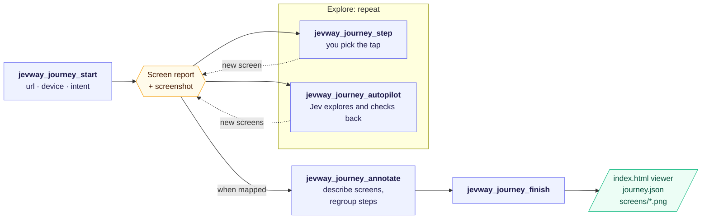

# Journey maps

A journey map records how a person moves through a site on a phone: every screen, what kind of screen it is, the taps
that lead on, and what's broken along the way. Use it for UX reviews, QA sweeps and competitor teardowns. A
`jevway_task` run reaches one goal; a journey records the paths.

The output is a folder you can open and share:

- `index.html`, a viewer with every screen, the flows between them, and the QA findings;
- `journey.json`, the same map as data;
- `screens/*.png`, one screenshot per screen.

It goes to `out_dir`, or `$JEVWAY_JOURNEYS_DIR/<host>/<timestamp>` (default `./journeys/…`).

## The loop

Every reply to `start`, `step` and `autopilot` carries a JSON report and a light JPEG of the screen, so a multimodal agent
sees what Jev saw. The same Chrome is open to chrome-devtools, for anything the report doesn't show.

## `jevway_journey_start`

Opens a URL on an emulated device and records the first screen.

| Parameter | What it does |
| --- | --- |
| `url` | Where to start. |
| `device` | `iphone-15` (default), `pixel-8`, `laptop` or `desktop`. |
| `intent` | Focus on one journey ("find and open a stay in Lisbon"). Leave it out to explore the core journeys. |
| `values` | Text autopilot may type: search queries, made-up names. Use made-up data only. |
| `stay_within` | A URL prefix autopilot must stay under, such as one project in a multi-project app. Default: the same origin. |
| `out_dir` | Where to write the map. |

The server's `JEVWAY_ALLOWED_HOSTS` and `JEVWAY_BLOCKED_HOSTS` hold for journeys: a start page outside them is never
opened, a step that lands outside them is refused (take `back`), and autopilot backs out of such a page.

## The screen report

| Field | What it holds |
| --- | --- |
| `screen` | `id`, whether it's new, `url`, `title`, its `type` with a confidence, the UI `patterns` seen, and the `primary_action` Box found (Jev 1.14 on the TypeSafe API). |
| `screenshot` | The path of this screen's PNG. |
| `qa` | Findings on this screen, each with a `kind`, `severity` (`high`, `medium`, `low`) and `detail`. |
| `jev` | The tap Jev suggests, `ranked_taps` (the most likely next taps), `commit_risk` of the suggested tap, how likely the screen is a sign-in wall, and the request's latency. |
| `elements` | The tappable elements by index, for `jevway_journey_step`. |
| `progress` | Screens and steps so far, the flows, and the viewer's path. |

**Screen types:** home, search, results, detail, filters, map, form, auth, checkout, confirmation, account,
navigation_menu, modal, onboarding, content, error.

**Patterns:** bottom navigation, top app bar, menu button, search bar, card list, carousel, filter chips, sheet or
dialog, date picker, map view, form fields, primary call to action, consent banner, price display.

**QA findings:** console errors, failed requests, horizontal overflow, tap targets under 44 px, unlabelled controls,
error states, empty states, dead ends, and `control_not_in_dom` (a control visible on the screenshot that has no DOM
element, found by Box).

Jev also judges whether a screen duplicates one already visited, so revisits don't become new screens.

## `jevway_journey_step`

Moves one step, and records what you learned about the screen you're leaving.

| Parameter | What it does |
| --- | --- |
| `journey` | The id from `start`. |
| `next` | An element index from `elements` or `ranked_taps` (a dropdown option looks like `"3:2"`), or `back`, `restart`, `scroll_down`, `scroll_up`, or `screen:<id>` (replay the recorded path to that screen). |
| `value` | Text to type into the chosen field. |
| `flow` | The flow this step belongs to, such as `"Homes/Searching homes"`. It sticks for later steps. |
| `description` | What the screen you're leaving is, for the viewer. |
| `insight` | A UX observation about it. |

A step taps whatever you name, a submit included. Stop at sign-in, payment and send steps.

## `jevway_journey_autopilot`

Lets Jev explore and come back with a log of every move.

| Parameter | What it does |
| --- | --- |
| `journey` | The id from `start`. |
| `screens` | Without an intent: check back after this many new screens (at most 30). |
| `intent` | Keep going until this is reached. |
| `flow` | The flow to record the steps under. |

On each screen it takes Jev's suggested tap first, then the remaining taps by likelihood, then one scroll, then back. It
skips taps it already tried and off-site links, backs out of explored screens, and skips irreversible taps while
exploring. It stops at a sign-in wall, and, with an intent, when the intent is reached or at the first irreversible
step. The reply says why it stopped (`auth_wall`, `intent_reached`, `irreversible_action`) and lists what it discovered.

## `jevway_journey_annotate`

Adds a `description` and an `insight` to any screen by id. With `relabel: {from_step, to_step, flow}` it moves steps
(0-based, as in `journey.json`) into a named flow. It only edits the local map.

## `jevway_journey_finish`

Writes the final `journey.json` and `index.html`, closes the tab (`keep_tab: true` leaves it), and returns the viewer's
path, the screen and step counts, the flows, the QA findings by severity, and the screens still missing a description.

## A typical session

1. `jevway_journey_start` with the site and an `intent`, or none to explore.
2. `jevway_journey_autopilot` with the same intent, or `screens: 8` to explore.
3. Look at the discovered screens' screenshots, then `jevway_journey_annotate` each with a description and an insight.
4. `jevway_journey_step` by hand where autopilot stopped or skipped something you want covered.
5. `jevway_journey_finish`, then open `index.html`.
